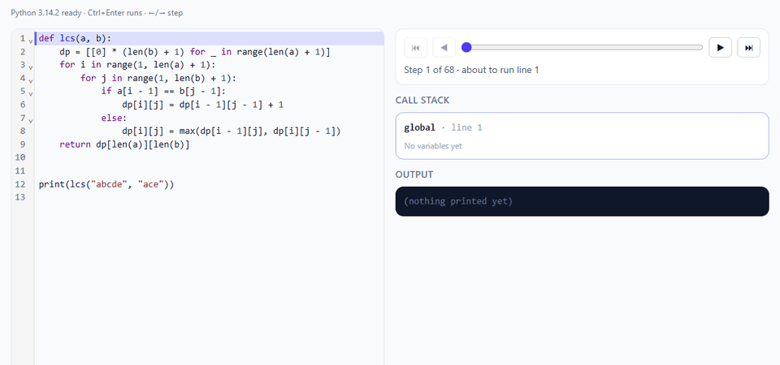

# Spar

Find the interview patterns you're weakest at, then spend whatever time you have on exactly those. Free, local-first, with its ML running in your browser.



> Status: early development (Phase 3 complete: drills, recommender and visualizer). See [BUILD_PLAN.md](BUILD_PLAN.md).

## What works today

- **Comfort survey:** rate each topic from 1 (never seen it) to 5 (comfortable with hards). Ratings set each pattern's starting estimate, so recommendations are personal from the first minute; real answers take over within a few questions, and the skill graph flags ratings that disagree with what you measure. New users see it on their first visit; retake it from the skill graph.
- **Time-boxed sessions:** pick 10, 30 or 60 minutes (or no limit). Each item is chosen for your weakest patterns and to fit the time left, and the session ends with a summary of how each pattern moved.
- **Timed mode:** a per-item countdown, like an online assessment; running out counts as a miss.
- **Pattern drills:** 120 original items (92 name-the-pattern, 28 time-complexity) across 14 patterns. Read a problem description, name the pattern (or the Big-O), and get instant feedback with the signal phrases that give it away. Choices are shuffled, and an item doesn't come back within 30 drills. Keys `1`–`4` answer, `Enter` moves on.
- **Recommendations:** every pick says why it was chosen ("Sliding Window: low mastery, not practiced in over a week"). One set of rules ranks both drills and LeetCode problems: weakness and uncertainty, a 60 to 75% predicted success band, a boost for patterns unpracticed for a week, a penalty while a prerequisite is weak, time fit, and freshness (no LeetCode repeat within a week; unaided solves return only as reviews). Sessions of 30+ minutes include one recommended LeetCode problem.
- **LeetCode log:** paste a link, number or slug and say how it went (on your own, with hints, or after viewing the solution). Each problem counts once, by its best outcome; only unaided solves move mastery fully.
- **Skill graph:** 14 patterns in 4 layers, each with an Elo-based mastery estimate, a 95% band, and LeetCode solved counts by difficulty. "Share image" turns it into a 1200x630 PNG card (download, copy or share) with your scores and totals and nothing personal.
- **Visualize:** step through Python line by line in the browser. Lists and strings draw as cells with index pointers (i, j, lo, hi, mid, left, right, ...) as labelled arrows and the lo..hi or left..right range shaded. Linked lists and binary trees (found by their next / left / right fields) draw as boxes and node diagrams, with every frame's pointers marked (so a recursion's path is visible) and just-rewired links highlighted. 2D lists draw as DP tables showing the cell just written, the cell the current line will write and the cells it reads, and recursive code gets a recursion tree where repeated calls show as cache hits (memoized) or recomputed work. Also shows the call stack, every variable (changes highlighted), printed output, and the current or failing line highlighted in the editor. Runs CPython (Pyodide) in a Web Worker, so code never touches the page or a server; runaway loops stop at 1,000 steps, and anything stuck in native code is killed after 10 seconds.
- **"Which pattern is this?":** on the LeetCode log tab, paste a problem you're stuck on and get the likely patterns as a hint, with each pattern's tell-tale signals. A distilled MiniLM blended with TF-IDF (Model #1) runs in a Web Worker in about 20 ms; the text never leaves the browser.
- **Local-first:** answers are stored in IndexedDB on your device. No account, no server.

## How it works

Every answer updates a per-pattern ability `theta` and a per-item difficulty `b` on the logit scale, where `P(correct) = sigmoid(theta - b)`. That is the same scale the Rasch model uses, so the planned adaptive placement test can reuse it. Skill state is rebuilt by replaying the stored responses, so the response log is the single source of truth. The math lives in [apps/web/src/engine](apps/web/src/engine) and is unit-tested.

Every tunable number (learning rates, priors, the target success band, ranking weights) lives in one versioned file, [params.ts](apps/web/src/engine/params.ts). The v1 values are hand-set. Each drill pick and in-session LeetCode task is logged with its features, runner-up scores, tie-break noise, params version and outcome, so a later phase can re-estimate those numbers from real usage. "Export my data" on the skill graph page downloads everything as JSON.

## Repo layout

```
apps/web/     Vite + React + TypeScript app (src/workers: Pyodide worker and the Python tracer)
apps/api/     Cloudflare Worker + D1 (Phase 5)
content/      patterns.yaml, items/ (one YAML file per item) and lc_catalog.yaml, validated at build time
ml/           training, evaluation, model cards (Phase 4)
```

## Local setup

Requires Node 20.17+.

```sh
npm install
npm run dev        # http://localhost:5173
npm run ci         # lint, typecheck, test, build
```

Copy `.env.example` to `.env` if you need to override settings. Nothing is required yet.

## Adding content

Add a file to `content/items/` named after its id (e.g. `pat-017.yaml`). The schema is in [apps/web/src/content/schema.ts](apps/web/src/content/schema.ts); `npm test` and `npm run build` both reject invalid items. All problem text is original. `content/lc_catalog.yaml` holds only LeetCode slugs, numbers, difficulty labels and our own pattern tags; Spar links out to leetcode.com and never copies problem text.

## License

MIT
